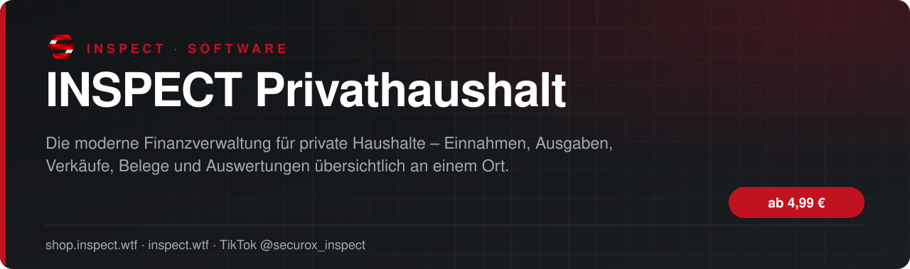
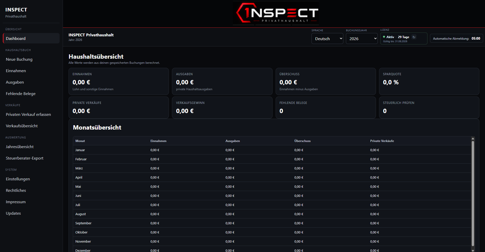

<!-- inspect-showcase: automatisch erzeugt, Änderungen bitte im Shop vornehmen -->

  
  
  
  

  
  
  

 

> 🇬🇧 **English:** INSPECT Privathaushalt – software by SecuroX Inspect. Purchase and licensing exclusively at [shop.inspect.wtf](https://shop.inspect.wtf). Product details below are in German – questions are welcome on [Discord](https://discord.gg/inspect).

 

## Das Wichtigste auf einen Blick

<table>
  <tr>
    <td width="50%" valign="top">✔&nbsp; <b>Übersichtliche Erfassung privater Einnahmen</b></td>
    <td width="50%" valign="top">✔&nbsp; <b>Strukturierte Verwaltung laufender Ausgaben</b></td>
  </tr>
  <tr>
    <td width="50%" valign="top">✔&nbsp; <b>Separate Verwaltung privater Verkäufe</b></td>
    <td width="50%" valign="top">✔&nbsp; <b>Modernes Dashboard mit den wichtigsten Finanzwerten</b></td>
  </tr>
</table>

## Überblick

#### DEINE PRIVATEN FINANZEN – EINFACH UND ÜBERSICHTLICH VERWALTET

Mit INSPECT Privathaushalt verwaltest du Einnahmen, Ausgaben, private Verkäufe und Belege übersichtlich in einer einzigen Anwendung.

#### EINNAHMEN UND AUSGABEN

Erfasse Buchungen strukturiert, ordne Kategorien zu und ergänze Beträge, Daten, Beschreibungen und Belege.

#### PRIVATE VERKÄUFE

Dokumentiere private Verkäufe getrennt von deinen übrigen Einnahmen und behalte Anschaffungsdatum, Verkaufsdatum und Verkaufspreis im Blick.

#### AUSWERTUNGEN

Vergleiche Monate und Jahre, erkenne finanzielle Entwicklungen und erhalte eine klare Übersicht über deine Einnahmen und Ausgaben.

#### BELEGE UND EXPORT

Ordne Belege direkt den passenden Buchungen zu und exportiere deine Daten für die eigene Ablage oder weitere Bearbeitung.

#### LOKALE DATENSPEICHERUNG

INSPECT Privathaushalt arbeitet lokal auf deinem Windows-PC. Deine persönlichen Finanzdaten müssen nicht dauerhaft in einer externen Cloud gespeichert werden.

◆ FÜR WEN IST DIE SOFTWARE GEEIGNET?

Ideal für Einzelpersonen, Familien und private Haushalte, die ihre Finanzen einfach, nachvollziehbar und übersichtlich organisieren möchten.

#### HINWEIS

INSPECT Privathaushalt dient der privaten Organisation und Dokumentation von Finanzdaten. Die Software ersetzt keine individuelle Steuer-, Rechts- oder Finanzberatung.

## Alle weiteren Funktionen

- Monats- und Jahresübersichten
- Automatische Berechnung von Einnahmen, Ausgaben und Differenzen
- Kategorisierung und nachvollziehbare Zuordnung von Buchungen
- Erfassung von Buchungsdatum und zusätzlichen Informationen
- Belegverwaltung für eine saubere Dokumentation
- Übersicht fehlender oder noch nicht zugeordneter Belege
- Filter- und Suchfunktionen für vorhandene Einträge
- Bearbeiten und Korrigieren bereits erfasster Buchungen
- Auswertungen zur finanziellen Entwicklung
- Exportmöglichkeiten für Archivierung und Weiterverarbeitung

<b>9 weitere Funktionen anzeigen</b>

- Getrennte Darstellung von Einnahmen, Ausgaben und Verkäufen
- Lokale Datenspeicherung auf dem eigenen Windows-PC
- Keine dauerhafte Cloudspeicherung erforderlich
- Moderne schwarz-rote INSPECT-Oberfläche
- Klare Navigation und verständliche Eingabemasken
- Für private Haushalte und Einzelpersonen geeignet
- Mehrsprachige Benutzeroberfläche
- Datensicherungs- und Wiederherstellungsfunktionen
- Fortlaufende Weiterentwicklung der Software

## Laufzeiten & Preise

| Laufzeit | Preis |
|:--|--:|
| 3 Tage | **4,99 €** |
| 7 Tage | **9,99 €** |
| 14 Tage | **19,99 €** |
| 30 Tage | **24,99 €** |
| 3 Monate | **29,99 €** |
| 6 Monate | **49,99 €** |
| 12 Monate | **69,99 €** |
| 24 Monate | **99,99 €** |
| Lifetime | **249,99 €** |

Sichere Zahlung mit PayPal oder Kreditkarte · Rechnung als PDF · Support auf Deutsch

## So einfach geht's

1. **Im Shop kaufen** – sicher bezahlen mit PayPal oder Kreditkarte.
2. **Sofort loslegen** – Download und Lizenz stehen direkt nach Zahlungseingang in deinem Kundenkonto bereit, die Rechnung erhältst du als PDF.
3. **Einrichten** – bei Fragen hilft dir unser Support im Discord weiter.

## Warum INSPECT?

<table>
  <tr>
    <td width="50%" valign="top"><b>🇩🇪 Entwickelt in Deutschland</b> Konzeption, Entwicklung und Support aus einer Hand.</td>
    <td width="50%" valign="top"><b>💬 Persönlicher Support</b> Schnelle Hilfe auf Deutsch im INSPECT Discord.</td>
  </tr>
  <tr>
    <td width="50%" valign="top"><b>🔒 Sichere Zahlung</b> PayPal oder Kreditkarte, Rechnung automatisch als PDF.</td>
    <td width="50%" valign="top"><b>⚡ Sofort verfügbar</b> Download und Lizenz direkt nach der Zahlung im Kundenkonto.</td>
  </tr>
</table>

## Häufige Fragen

<b>Wie erhalte ich das Produkt?</b>

 

Nach bestätigter Zahlung stehen Download und Lizenz in deinem Kundenkonto bereit. Die Rechnung erhältst du als PDF.

<b>Wie funktionieren die Laufzeiten?</b>

 

Du wählst beim Kauf die passende Laufzeit. Die Lizenz ist danach sofort aktiv und in deinem Kundenkonto einsehbar.

<b>Bekomme ich Hilfe bei der Einrichtung?</b>

 

Ja – unser Support hilft dir im [INSPECT Discord](https://discord.gg/inspect) persönlich und auf Deutsch.

<b>Wo kaufe ich offiziell?</b>

 

Ausschließlich im INSPECT Shop unter [shop.inspect.wtf](https://shop.inspect.wtf). Angebote von Dritten stammen nicht von uns.

## Kontakt

| | |
|:--|:--|
| 🛒 Shop | [shop.inspect.wtf](https://shop.inspect.wtf) |
| 🌐 Website | [inspect.wtf](https://inspect.wtf) |
| 💬 Discord | [discord.gg/inspect](https://discord.gg/inspect) |
| 🎬 TikTok | [@securox_inspect](https://www.tiktok.com/@securox_inspect) |
| ✉️ E-Mail | [info@inspect.wtf](mailto:info@inspect.wtf) |

---

<b>SecuroX Inspect</b> · Offizielle Produktpräsentation · Dieses Repository enthält keinen Quellcode und keine Produktdateien. 
Kauf und Lizenzen ausschließlich über <a href="https://shop.inspect.wtf">shop.inspect.wtf</a> · Inhalte werden automatisch aus dem Shop aktualisiert.

